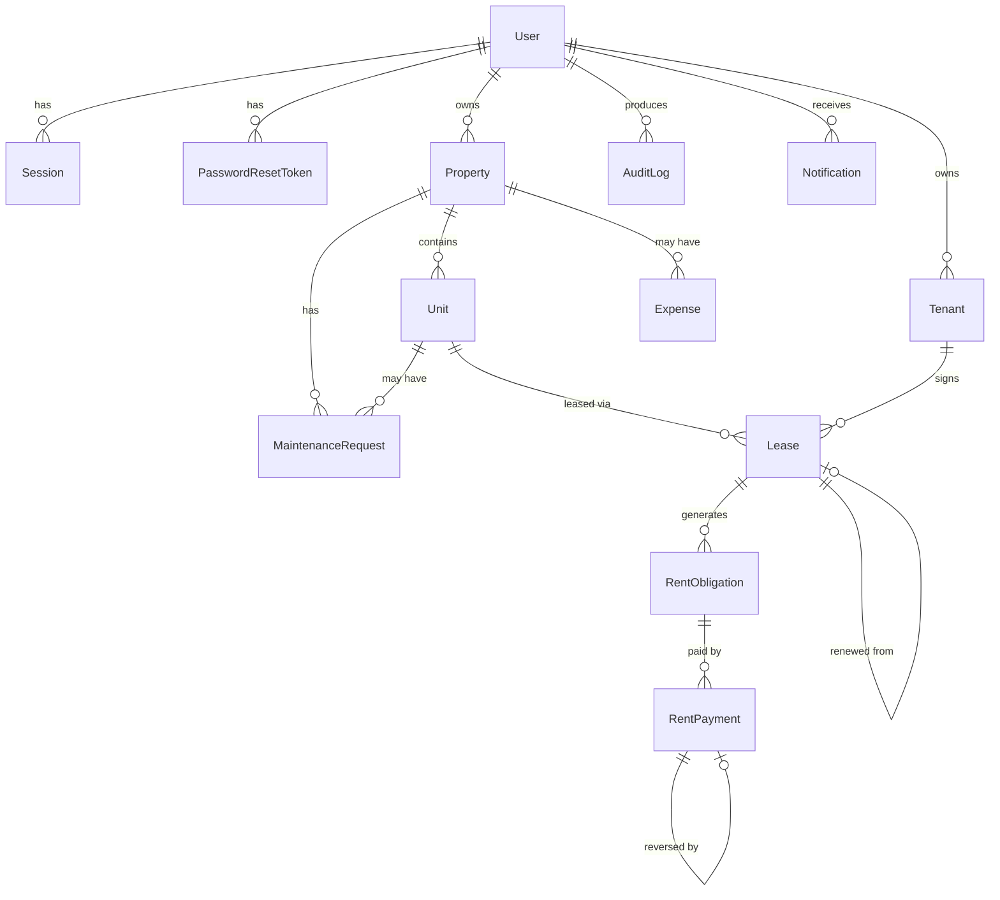

# Database

13 tables, PostgreSQL, Prisma schema at `apps/api/prisma/schema.prisma`, migration `20260101000000_init` (hand-written SQL plus the `lease_no_overlap` exclusion constraint and CHECK constraints). Foreign keys to business data are `ON DELETE RESTRICT`; only `Session` and `PasswordResetToken` cascade from `User`.

Every business table also carries `ownerId → User`.

Key constraints: `Unit(propertyId, number)` unique · `RentObligation(leaseId, periodMonth)` unique · `RentPayment(ownerId, idempotencyKey)` unique, `reversesId` unique · `Notification(ownerId, dedupeKey)` unique · CHECKs: lease dates, due day 1–28, non-negative amounts, `0 ≤ paidAmount ≤ amountDue`, payment sign matches kind, expense amount > 0 · EXCLUDE: no overlapping ACTIVE leases per unit. Indexes cover owner+status/date lookups.

Create from empty DB: `npm run db:migrate`. After any schema change run `npm run db:migrate:dev -w apps/api` to generate a new migration. **Run `prisma migrate diff` once** against the init migration to confirm no drift (the init SQL was written by hand, not generated).
